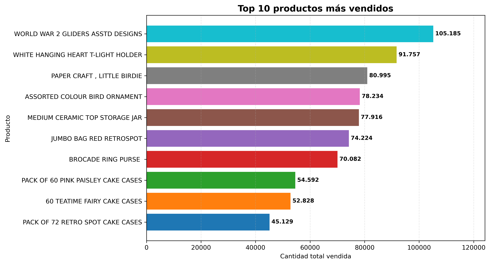
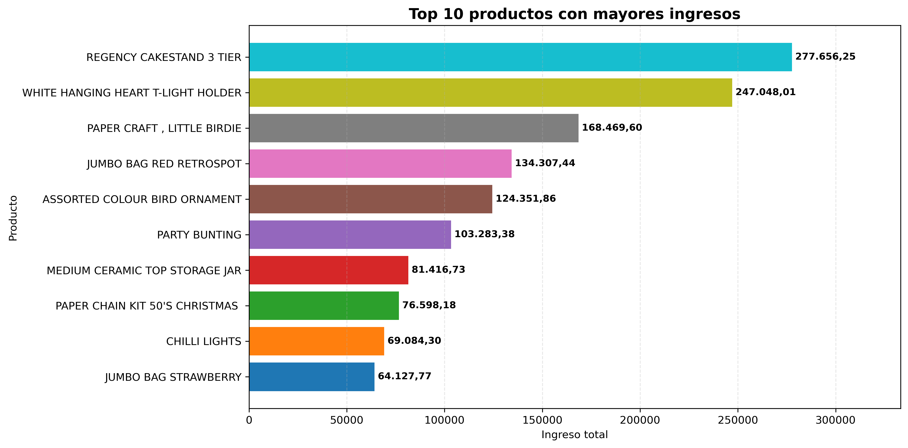
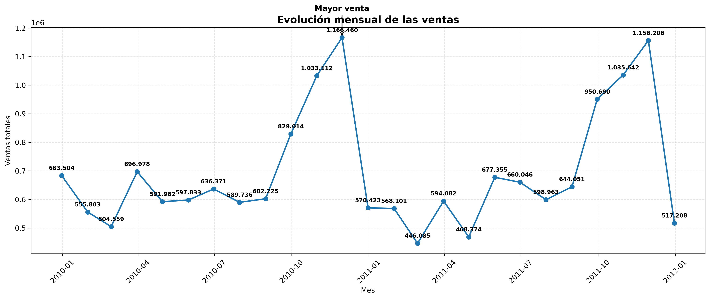
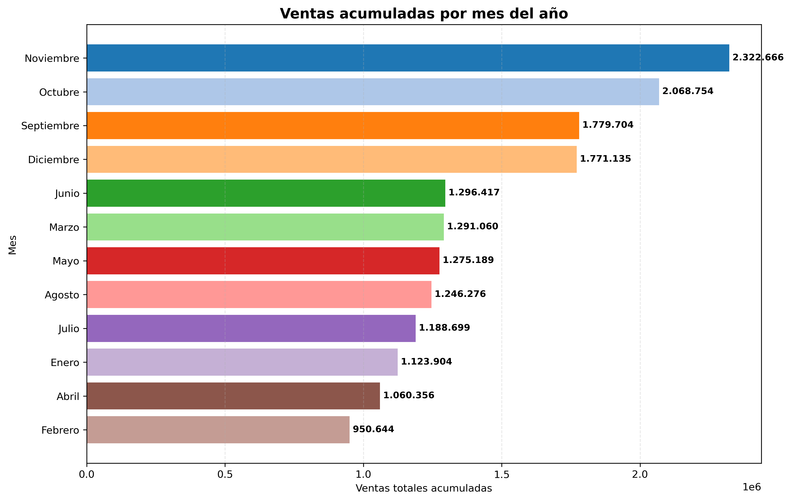
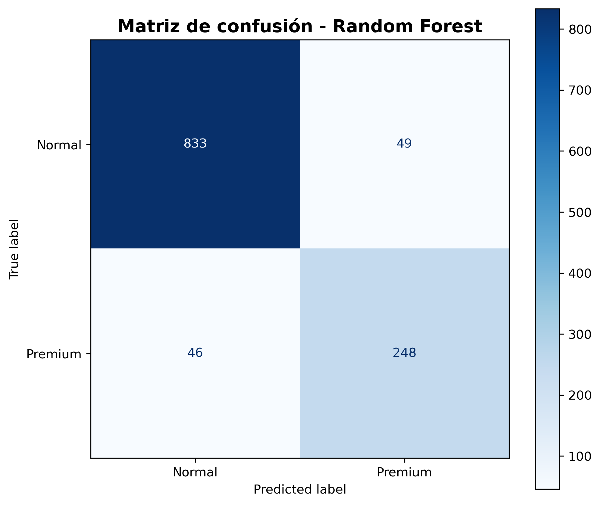
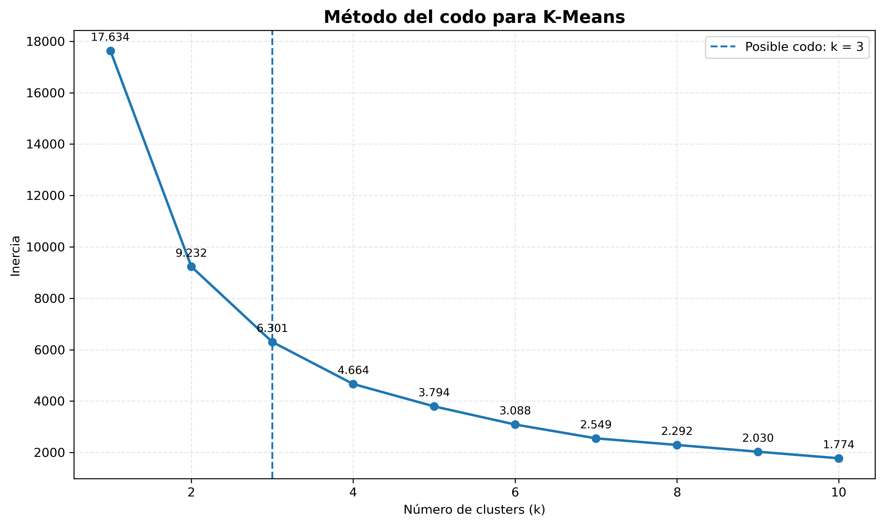
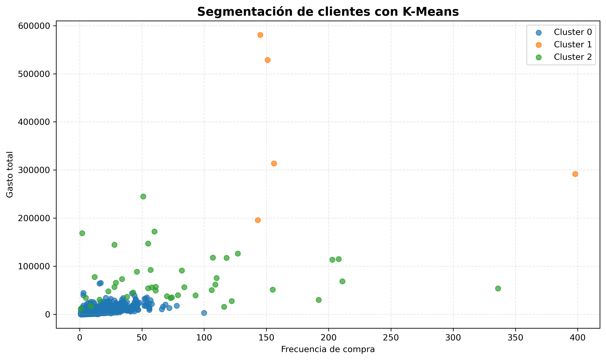
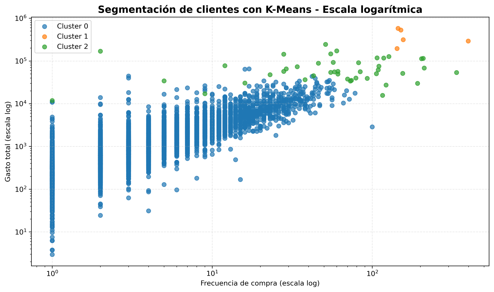
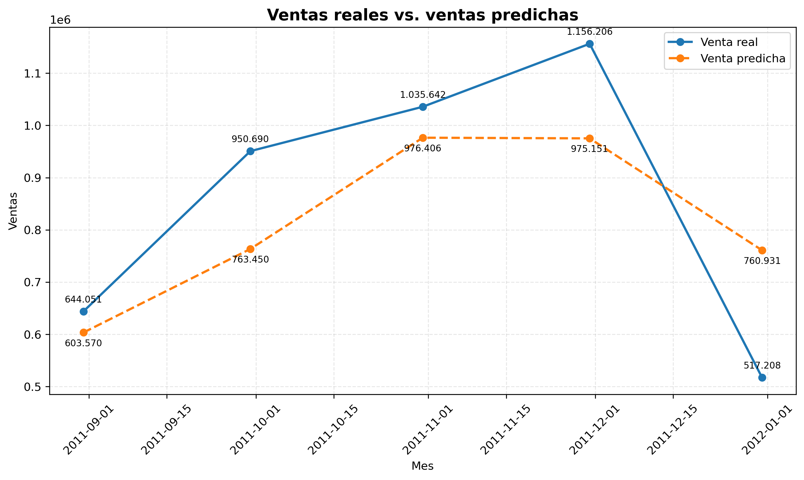

# Taller 02 - Aprendizaje de Máquina para el Análisis del Rendimiento de Ventas en Comercio Electrónico

## Maestría en Ciencia de Datos

Aplicación de técnicas de aprendizaje automático sobre el conjunto de datos **Online Retail II** utilizando Python, Pandas, NumPy, Matplotlib y Scikit-learn.

---

## Descripción del proyecto

Este proyecto tiene como finalidad desarrollar un proceso completo de análisis y modelado sobre el conjunto de datos **Online Retail II**.

El trabajo integra preparación y limpieza de datos, análisis exploratorio, clasificación de clientes, segmentación mediante técnicas de clustering y predicción de ventas.

El análisis busca obtener información relevante sobre:

- Comportamiento de compra de los clientes.
- Identificación de clientes Normales y Premium.
- Formación de segmentos de clientes.
- Productos con mayor demanda.
- Productos con mayor generación de ingresos.
- Comportamiento temporal y estacional de las ventas.
- Predicción de ventas futuras.

El desarrollo fue realizado utilizando Python y librerías orientadas al análisis de datos y aprendizaje automático como Pandas, NumPy, Matplotlib y Scikit-learn.

---

## Objetivos del proyecto

### Objetivo general

Aplicar técnicas de aprendizaje automático sobre datos de comercio electrónico para analizar el comportamiento de los clientes, identificar segmentos y desarrollar un modelo de predicción de ventas.

### Objetivos específicos

- Realizar la exploración y limpieza del conjunto de datos Online Retail II.
- Analizar las principales características del comportamiento de ventas.
- Clasificar clientes en las categorías Normal y Premium.
- Aplicar K-Means y Mean Shift para segmentar clientes.
- Comparar los resultados de las técnicas de agrupamiento.
- Construir un modelo para predecir ventas mensuales.
- Evaluar el desempeño de los modelos mediante métricas apropiadas.

---

## Dataset utilizado

### Online Retail II

El conjunto de datos utilizado corresponde a **Online Retail II**, que contiene transacciones realizadas por un comercio electrónico del Reino Unido entre diciembre de 2009 y diciembre de 2011.

El archivo contiene dos hojas:

- `Year 2009-2010`
- `Year 2010-2011`

Ambas hojas fueron integradas para trabajar con el período completo.

### Variables principales

| Variable | Descripción |
|---|---|
| Invoice | Número de factura o identificador de la transacción |
| StockCode | Código del producto |
| Description | Descripción del producto |
| Quantity | Cantidad adquirida |
| InvoiceDate | Fecha y hora de la transacción |
| Price | Precio unitario |
| Customer ID | Identificador del cliente |
| Country | País asociado a la transacción |

### Características iniciales del dataset

Antes del proceso de limpieza, el conjunto de datos contenía:

- **1.067.371 registros**
- **8 variables**

---

## Herramientas utilizadas

| Herramienta | Aplicación |
|---|---|
| Python | Lenguaje principal utilizado para el análisis y modelado |
| Pandas | Manipulación, limpieza y transformación de datos |
| NumPy | Operaciones numéricas |
| Matplotlib | Generación de visualizaciones |
| Scikit-learn | Clasificación, clustering y regresión |
| Jupyter Notebook | Desarrollo y documentación del proyecto |

---

## Metodología aplicada

El proyecto se desarrolló mediante las siguientes etapas:

### 1. Preparación y limpieza de datos

- Integración de las dos hojas del archivo.
- Identificación de valores faltantes.
- Identificación y eliminación de registros duplicados.
- Identificación y eliminación de pedidos cancelados.
- Eliminación de transacciones sin `Customer ID`.
- Eliminación de registros con precio igual a cero.
- Creación de la variable `TotalVenta`.

### Resultado final de la limpieza

Después de aplicar los procesos de depuración, el dataset quedó conformado por:

- **779.425 registros válidos**
- **8 variables originales**
- **1 variable adicional: `TotalVenta`**

---

## Análisis exploratorio de datos

Se analizaron principalmente las siguientes variables:

- `Quantity`
- `Price`
- `TotalVenta`
- `Description`
- `InvoiceDate`

### Productos con mayor volumen vendido

El producto con mayor número de unidades vendidas fue:

**WORLD WAR 2 GLIDERS ASSTD DESIGNS**

con aproximadamente **105.185 unidades**.

### Productos con mayores ingresos

El producto con mayor generación de ingresos fue:

**REGENCY CAKESTAND 3 TIER**

con aproximadamente **277.656,25**.

### Comportamiento temporal de las ventas

Las ventas presentan un comportamiento estacional.

Los mayores niveles de ventas se concentran principalmente entre:

- Septiembre.
- Octubre.
- Noviembre.

Noviembre presenta el mayor volumen acumulado de ventas dentro del período analizado.

---

## Clasificación de clientes

Los clientes fueron clasificados en dos categorías:

- **Normal**
- **Premium**

Se utilizó el gasto total acumulado como criterio de clasificación, considerando como Premium a los clientes ubicados en el **25% superior de la distribución**.

### Modelo utilizado

Se entrenó un modelo:

**Random Forest Classifier**

### Resultados

| Métrica | Resultado |
|---|---:|
| Accuracy | 91,92% |
| F1-score Normal | 0,95 |
| F1-score Premium | 0,84 |

El modelo mostró un buen desempeño general para diferenciar clientes Normales y Premium.

---

## Segmentación de clientes

Se aplicaron dos algoritmos de agrupamiento:

- K-Means.
- Mean Shift.

Las variables utilizadas fueron:

- Frecuencia de compra.
- Cantidad total adquirida.
- Gasto total.

### K-Means

Mediante el método del codo se seleccionaron **3 clusters**.

El modelo obtuvo:

**Silhouette Score = 0,9398**

### Mean Shift

Mean Shift identificó automáticamente:

**81 clusters**

y obtuvo:

**Silhouette Score = 0,6418**

### Comparación

| Algoritmo | Número de clusters | Silhouette Score |
|---|---:|---:|
| K-Means | 3 | 0,9398 |
| Mean Shift | 81 | 0,6418 |

K-Means presentó mejores resultados para este conjunto de datos debido a su mayor separación entre grupos y facilidad de interpretación comercial.

---

## Predicción de ventas

Para la predicción se construyó una serie mensual de ventas y se crearon las siguientes variables:

- Año.
- Mes.
- Tendencia temporal.
- Venta del mes anterior.

### Modelo utilizado

Se entrenó un:

**Random Forest Regressor**

utilizando los primeros períodos para entrenamiento y los últimos meses para prueba.

### Resultados

| Métrica | Resultado |
|---|---:|
| MAE | 142.347,13 |
| RMSE | 162.719,52 |
| R² | 0,5450 |

El modelo logró capturar parcialmente la tendencia general de las ventas.

También se realizó una evaluación complementaria excluyendo diciembre de 2011, debido a que este mes contiene información únicamente hasta el día 9.

---

# Visualizaciones generadas

Durante el proyecto se generaron diferentes visualizaciones para apoyar la interpretación de los resultados.

## 1. Productos más vendidos

Permite identificar los productos con mayor cantidad de unidades comercializadas.



---

## 2. Productos con mayores ingresos

Permite identificar los productos que generan una mayor contribución económica.



---

## 3. Evolución mensual de las ventas

Permite observar la evolución de las ventas a lo largo del período analizado e identificar meses de crecimiento y reducción.



---

## 4. Estacionalidad de las ventas

Permite comparar las ventas acumuladas según el mes del año e identificar períodos de mayor actividad comercial.



---

## 5. Matriz de confusión

Permite evaluar visualmente el desempeño del modelo Random Forest utilizado para clasificar clientes Normales y Premium.



---

## 6. Método del codo para K-Means

El método del codo permitió evaluar diferentes valores de `k` y seleccionar **3 clusters** como una solución adecuada para la segmentación.



---

## 7. Segmentación de clientes con K-Means

Permite visualizar la distribución de los clientes según su frecuencia de compra y gasto total.



---

## 8. Segmentación K-Means en escala logarítmica

Debido a la existencia de clientes con niveles de frecuencia y gasto considerablemente superiores al promedio, se utilizó una escala logarítmica para mejorar la visualización de los grupos.

Esta transformación se utiliza únicamente con fines gráficos y no modifica el modelo entrenado.



---

## 9. Ventas reales vs. ventas predichas

Permite comparar las ventas reales del conjunto de prueba con las estimaciones generadas por el modelo Random Forest Regressor.



---

## Principales resultados

Los principales resultados obtenidos durante el desarrollo del proyecto fueron:

- El dataset original estuvo compuesto por **1.067.371 registros**.
- Después de la limpieza se obtuvieron **779.425 registros válidos**.
- Se identificaron **5.878 clientes**.
- El producto con mayor volumen vendido fue **WORLD WAR 2 GLIDERS ASSTD DESIGNS**, con aproximadamente **105.185 unidades**.
- El producto con mayores ingresos fue **REGENCY CAKESTAND 3 TIER**, con aproximadamente **277.656,25**.
- Noviembre presentó el mayor volumen acumulado de ventas.
- El modelo Random Forest Classifier alcanzó una exactitud del **91,92%**.
- K-Means obtuvo un Silhouette Score de **0,9398** con **3 clusters**.
- Mean Shift obtuvo un Silhouette Score de **0,6418** y generó **81 clusters**.
- El Random Forest Regressor obtuvo un R² de **0,5450**.

---

## Dataset

El proyecto utiliza el conjunto de datos **Online Retail II** del UCI Machine Learning Repository.

Debido al tamaño del archivo original, el dataset no se incluye directamente en este repositorio.

Para ejecutar el notebook, se debe descargar el archivo y colocarlo en la misma carpeta del proyecto con el nombre:

`online_retail_II.xlsx`

---

## Estructura del repositorio

La organización del proyecto es la siguiente:

```text
Taller_02_Ciencia_Datos/
│
├── Taller_02_Ciencia_Datos.ipynb
│   └── Notebook principal con el proceso completo de análisis y modelado.
│
├── productos_mas_vendidos.png
│   └── Gráfico de productos con mayor cantidad vendida.
│
├── productos_mayores_ingresos.png
│   └── Gráfico de productos con mayores ingresos.
│
├── ventas_mensuales.png
│   └── Evolución mensual de las ventas.
│
├── estacionalidad_ventas.png
│   └── Ventas acumuladas según el mes del año.
│
├── matriz_confusion.png
│   └── Evaluación gráfica del modelo de clasificación.
│
├── metodo_codo_kmeans.png
│   └── Método del codo utilizado para seleccionar el número de clusters.
│
├── segmentacion_kmeans.png
│   └── Visualización de la segmentación obtenida mediante K-Means.
│
├── segmentacion_kmeans_log.png
│   └── Segmentación K-Means representada en escala logarítmica.
│
├── ventas_reales_predichas.png
│   └── Comparación entre ventas reales y predichas.
│
└── README.md
    └── Documentación general del proyecto.
```

---

## Conclusiones

El desarrollo del proyecto permitió aplicar un flujo completo de trabajo en ciencia de datos y aprendizaje automático, desde la preparación y limpieza de la información hasta la construcción y evaluación de modelos.

El proceso de limpieza permitió obtener un conjunto de datos consistente y adecuado para los análisis posteriores.

El análisis exploratorio permitió identificar productos de alta rotación, productos con mayor aporte económico y patrones estacionales en las ventas. Se observó especialmente un incremento de la actividad comercial durante los meses de septiembre, octubre y noviembre.

El modelo **Random Forest Classifier** obtuvo una exactitud del **91,92%**, mostrando un buen desempeño en la clasificación de clientes Normales y Premium.

En la segmentación de clientes, **K-Means** obtuvo mejores resultados que Mean Shift. K-Means alcanzó un Silhouette Score de **0,9398** con tres clusters, mientras que Mean Shift obtuvo un Silhouette Score de **0,6418** y generó 81 clusters. Por esta razón, K-Means presentó una estructura más clara y fácil de interpretar comercialmente.

Finalmente, el modelo **Random Forest Regressor** obtuvo un R² de **0,5450**, mostrando una capacidad predictiva moderada para estimar la evolución mensual de las ventas.

En conjunto, los resultados demuestran cómo las técnicas de aprendizaje automático pueden transformar información transaccional en conocimiento útil para comprender el comportamiento de los clientes, desarrollar estrategias de segmentación y apoyar la planificación comercial.

---

## Ejecución del proyecto

Para ejecutar el proyecto se requiere Python y las siguientes librerías:

```text
pandas
numpy
matplotlib
scikit-learn
```

El análisis puede ejecutarse desde Jupyter Notebook abriendo el archivo:

```text
Taller_02_Ciencia_Datos.ipynb
```

Las celdas deben ejecutarse en orden desde el inicio hasta el final.

---

## Autor

**Maestría en Ciencia de Datos**

Taller 02 - Aprendizaje de Máquina para el Análisis del Rendimiento de Ventas en Comercio Electrónico
